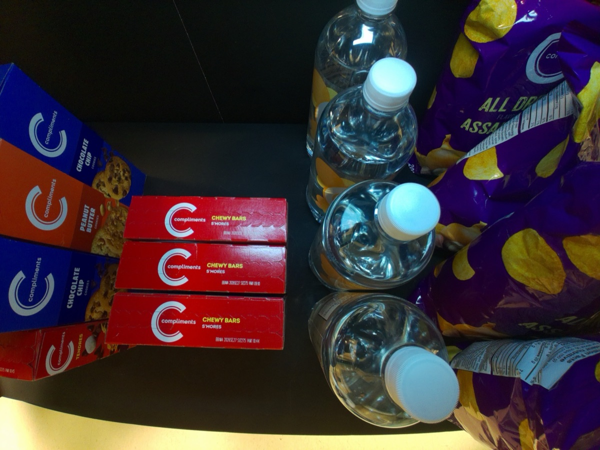
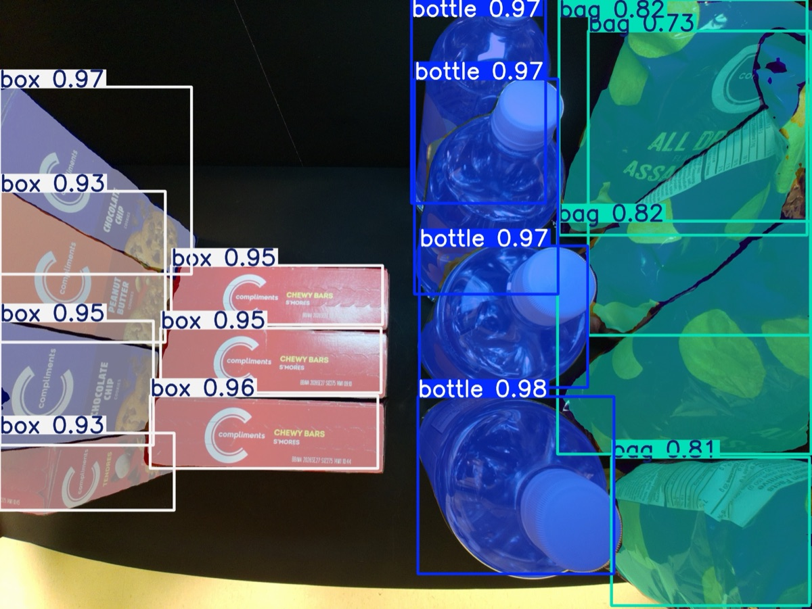
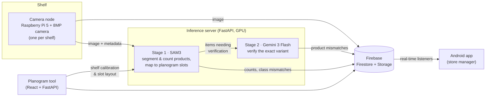
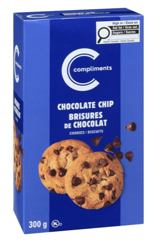
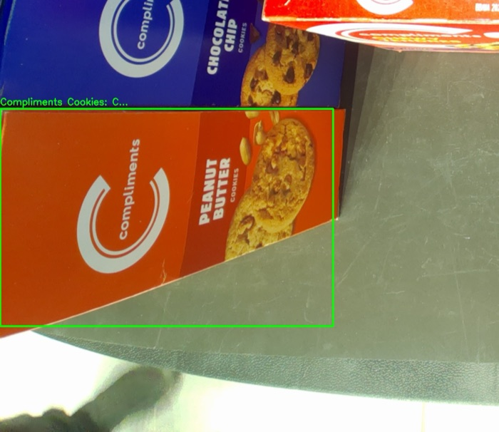
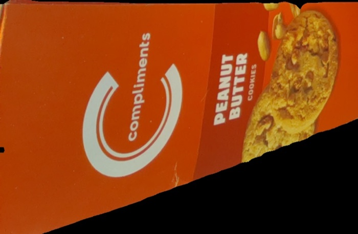
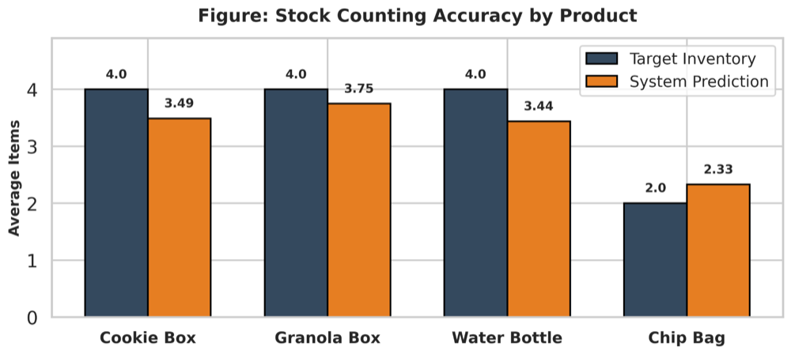
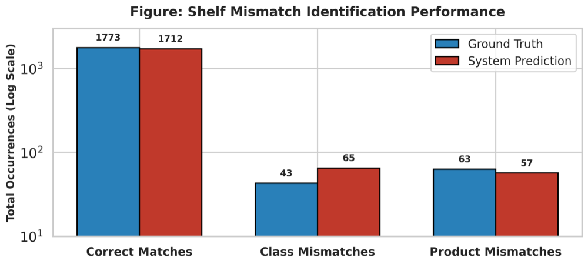

# ViziStock

**Smart shelf monitoring for retail stores.** ViziStock watches store shelves with low-cost Raspberry Pi cameras. It counts stock against a planogram, catches misplaced products down to the exact flavour or variant, and streams the results to a store manager's Android app in real time.

ViziStock was our University of Waterloo Electrical & Computer Engineering capstone design project (ECE 498A/B, 2025–2026).

<p align="center">
  
  
  
</p>
<p align="center"><sub>
  <b>Left:</b> raw frame from a shelf camera. &nbsp;
  <b>Middle:</b> SAM3 segments and classifies every product. &nbsp;
  <b>Right:</b> Gemini flags a <i>Peanut Butter</i> cookie box and a box of <i>S'mores</i> bars sitting in the <i>Chocolate Chip</i> slot.
</sub></p>

---

## Why

Retailers lose an estimated $1.77 trillion a year to "inventory distortion": overstock, out-of-stocks, and misplaced items. Most stores still find empty or messy shelves by having staff walk the aisles. Off-the-shelf object detectors can tell a *box* from a *bottle*, but not *Chocolate Chip* from *Peanut Butter* cookies in near-identical packaging.

ViziStock combines a segmentation model, a planogram, and a vision-language model to answer three questions for every shelf slot:

- **How many are left?** Stock counts, with an alert when a slot drops below its threshold.
- **Is the right *kind* of product here?** For example, a bag sitting in a box slot.
- **Is it the right *variant*?** For example, the right brand in the wrong flavour.

## How it works



1. **Set up the shelf.** In the [planogram tool](planogram_tool), you click the shelf's four corners on a live photo to compute a homography, a perspective transform that gives a flat, top-down "virtual shelf". You then divide that virtual shelf into slots, each with an expected product, allowed product types and a low-stock threshold.
2. **Capture.** A [camera node](camera_node) above each shelf takes a full-resolution photo every 20 seconds, uploads it to Firebase Storage, and sends it to the inference server.
3. **Segment and count (SAM3).** The [inference server](inference_server) runs [SAM3](https://ai.meta.com/sam3/) with text prompts (`box`, `chip bag`, `bottle`, `can`, …) to segment every product. A custom mask-merging step stops crinkled chip bags from being counted twice. Each item is projected onto the virtual shelf to find its slot. If its product type doesn't belong there, it's flagged right away.
4. **Verify the variant (Gemini).** The remaining items go to Gemini 3 Flash with a masked crop, the surrounding context, and a reference photo of the expected product, plus each item's dominant colour measured with OpenCV. A structured chain-of-thought prompt sets explicit rules for colour, partial text, and transparent packaging, and returns `MATCH` or `MISMATCH`.
5. **Sync.** The shelf state, its history, and mismatch logs are written to Firestore. The [Android app](android_app) shows live stock levels, low-stock alerts, and misplaced items highlighted on the shelf photo.

### What Gemini sees

SAM3 sees only "a box" sitting in a box slot, so the Peanut Butter cookies from the top image pass its type check. Gemini receives the slot's reference photo, the item in its surrounding context, and the item masked out on its own:

| Reference (expected product) | Annotated context | Masked crop |
|:---:|:---:|:---:|
|  |  |  |

> **Gemini:** *"The expected product is Chocolate Chip cookies in a blue box, but the item detected in the green box is Peanut Butter cookies in a red/orange box. This is a clear mismatch in both color and variant text."* → `MISMATCH`

### The app

<p align="center">
  
  
  
  
</p>

## Results

We evaluated the system on 169 labelled shelf images covering different lighting conditions and product arrangements.

| Metric | Result |
|---|---|
| Stock counting error, normal shelves (131 images) | **0.68 items** mean absolute error |
| Stock counting error, heavily occluded shelves (38 images) | 2.29 items MAE |
| Wrong-variant detection (Gemini) | **57 of 63** caught (90.5% recall) |
| End-to-end latency (capture → app) | **~16.5 s** on average |
| SAM3 segmentation | ~0.65 s per frame |
| Gemini verification (all items on a shelf, in parallel) | ~13.8 s |

<p align="center">
  
  
</p>

Ground truth counted *every* item physically on the shelf, including ones completely hidden behind taller products. The occluded set therefore measures what a single overhead camera can't see, not segmentation errors.

## Repository layout

```
├── camera_node/        Raspberry Pi scripts: capture shelf images and send them for processing
├── inference_server/   FastAPI + SAM3 + Gemini vision pipeline (runs on a GPU machine)
├── planogram_tool/     React + FastAPI web app for shelf calibration and slot layout
├── android_app/        Store manager app (Kotlin, Jetpack Compose, Firestore)
├── experiments/        Research scripts for approaches we evaluated (YOLO, SAM, Qwen, image diffing, …)
├── archive/
│   └── phase1_llmdet/  Our first end-to-end prototype, built on LLMDet
└── docs/images/        Images used in the READMEs
```

Each component has its own README with full details.

## Running it

### Prerequisites

| | |
|---|---|
| **Firebase project** | Firestore and Storage enabled; a service account key (Project Settings → Service Accounts) and an Android `google-services.json` |
| **Gemini API key** | From [Google AI Studio](https://aistudio.google.com/apikey) |
| **GPU machine** | NVIDIA GPU with CUDA (~8 GB+ VRAM), Python 3.10+, and the [SAM3 weights](https://huggingface.co/facebook/sam3) (`sam3.pt`, gated access) |
| **Shelf camera** | Raspberry Pi (we used a Pi 5) with a CSI camera module, on the same network as the GPU machine (we used [Tailscale](https://tailscale.com/)) |
| **Android Studio** | To build the app (min SDK 30) |

No credentials or model weights are included in this repo. Each component reads its secrets from environment variables or a git-ignored `.env` file; see each folder's `.env.example`.

### 1. Map the shelf

On the Pi, run `python camera_node/capture_server.py`. Then start the [planogram tool](planogram_tool) and walk through its four steps. Save to **both** to write `planogram_config.json` locally and publish it to Firestore for the app. Copy the JSON into `inference_server/` and `camera_node/`.

### 2. Start the inference server

```bash
cd inference_server
pip install -r requirements.txt
cp .env.example .env              # GEMINI_API_KEY, Firebase credentials & bucket
# add sam3.pt and one reference photo per slot in product_references/
python server.py                  # listens on :5000
```

### 3. Start a camera node on each Pi

```bash
cd camera_node
sudo apt install -y python3-picamera2
pip install -r requirements.txt
cp .env.example .env              # CAMERA_ID, INFERENCE_SERVER_URL, Firebase credentials & bucket
python polling_node.py            # or motion_node.py for motion-triggered capture
```

### 4. Run the app

Open `android_app/` in Android Studio, add your `google-services.json` to `app/`, and run it.

## Known issues and future work

- **Resolving a misplaced item in the app doesn't stick.** The flag the app writes is overwritten by the next frame's results. See [android_app/README.md](android_app/README.md#known-issue) for details and a suggested fix.
- **False class mismatches at slot boundaries.** The system flagged 65 class mismatches against 43 real ones. Items that lean across a slot line, or sit at the distorted edges of the frame, get projected into the neighbouring slot. Placing [ArUco markers](https://docs.opencv.org/4.x/d5/dae/tutorial_aruco_detection.html) on the shelf would let the planogram calibrate itself and correct for camera pose.
- **Every frame goes to Gemini.** Pixel-based change detection (MOG2/SSIM, still available in `camera_node/motion_node.py`) was too sensitive to glare and lighting to rely on. *Semantic* differencing would cut API cost a lot: compare SAM3 detections between frames, and only re-verify items that actually changed.
- **Occlusion.** One overhead camera can't count items hidden behind taller products. A second viewing angle would help.

## Tech stack

**Vision:** SAM3 (Ultralytics), Gemini 3 Flash, OpenCV · **Backend:** Python, FastAPI, PyTorch, asyncio · **Edge:** Raspberry Pi 5, Picamera2 · **Data:** Firebase Firestore & Storage · **App:** Kotlin, Jetpack Compose, Coil · **Planogram tool:** React, Vite, Tailwind CSS

## Team

Built by **Kanyinsola Adejola**, **David Chen**, **Akil Giri** and **Sovan Patnayak**.

Thanks to our capstone consultant, Dr. Mike Cooper-Stachowsky, for his guidance throughout the project.

## License

[MIT](LICENSE)
