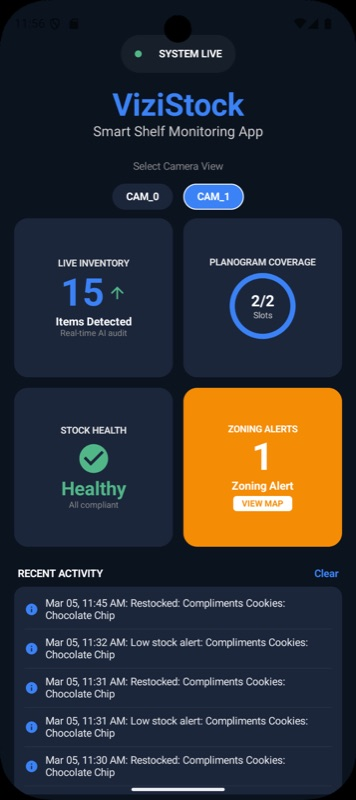
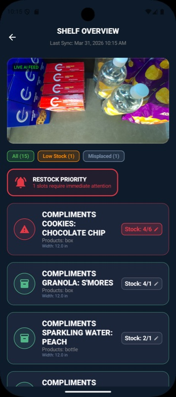
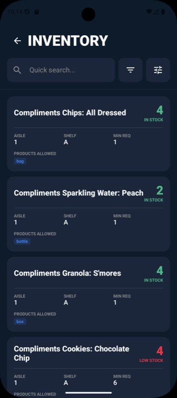
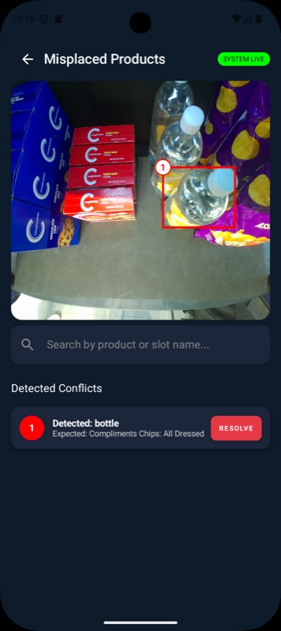

# Android App

The store manager's dashboard for ViziStock. It subscribes to Firestore in real time and shows each camera-equipped shelf's stock counts, low-stock alerts, and misplaced products. We chose native Android because retail staff already carry Android-based handhelds (e.g. Zebra scanners).

<p align="center">
  
  
  
  
</p>

## Screens

| Screen | File | What it shows |
|---|---|---|
| **Home** | `ui/HomeScreen.kt` | Live/connecting status, camera selector, summary cards (items detected, planogram coverage, stock health, zoning alerts) and recent activity. |
| **Shelf Overview** | `ui/ShelfOverviewScreen.kt` | Latest shelf photo, then one card per slot with its count vs. threshold. Filter chips (all / low stock / misplaced) and a restock-priority banner. Tap a slot to edit its low-stock threshold, which is saved to Firestore. |
| **Shelf Inventory** | `ui/ShelfInventoryScreen.kt` | Searchable list of slots with stock health, count, aisle and shelf. |
| **Inventory** | `ui/ItemInventoryScreen.kt` | Advanced search with aisle and shelf filters. |
| **Misplaced Products** | `ui/MisplacedProductsScreen.kt` | Shelf photo with numbered boxes over misplaced items, a list of conflicts, and a resolve action. |

## Architecture

The app follows MVVM. A single `ShelfViewModel` owns all state as Compose `mutableStateOf` values and keeps three Firestore listeners open. Screens read that state directly and recompose whenever it changes.

```
MainActivity
  └─ AppNavHost (Compose Navigation)
       ├─ HomeScreen               "home"
       ├─ ShelfOverviewScreen      "shelfOverview"
       ├─ ShelfInventoryScreen     "shelfInventory"
       ├─ ItemInventoryScreen      "itemInventory"
       └─ MisplacedProductsScreen  "misplacedProducts"

ShelfViewModel
  ├─ planogram listener  →  planograms/master_config
  ├─ inventory listener  →  inventory_current/{cameraId}
  └─ activity listener   →  activity_logs/{cameraId}/logs
```

`switchCamera(cameraId)` removes the listeners and re-attaches them for the new camera.

The ViewModel computes per-slot counts and low-stock alerts on the device, from the inventory document and the planogram thresholds. It writes "Low stock" and "Restocked" events to `activity_logs`.

```
app/src/main/java/com/example/vizistock/
├── MainActivity.kt          Entry point and navigation graph
├── ShelfViewModel.kt        State, Firestore listeners, stock/alert logic
├── model/
│   ├── PlanogramConfig.kt   MasterConfig, CameraConfig, SlotData, …
│   ├── Detection.kt         Detection, BBox
│   └── ActivityLog.kt       Activity feed entry
└── ui/                      One file per screen (see table above)
```

## Firestore data

| Path | Written by | Contents |
|---|---|---|
| `planograms/master_config` | [Planogram tool](../planogram_tool) | Planogram per camera: slot ranges, product names, valid classes, thresholds |
| `inventory_current/{cameraId}` | [Inference server](../inference_server) | Latest shelf image URL and every detected item per slot |
| `activity_logs/{cameraId}/logs` | This app | Low-stock / restock / resolved events (latest 10 shown) |

## Setup

1. Open this folder in Android Studio.
2. Register an Android app with package name `com.example.vizistock` in your Firebase project. Download its `google-services.json` into `app/` (the file is git-ignored).
3. Run on a device or emulator with API 30+.

## Known issue

**Resolving a misplaced item doesn't stick.** Tapping *Resolve* writes `app_misplaced_status = "resolved"` on the item, but:

- the listener checks a different field (`status`);
- the inference server overwrites the whole `inventory_current` document with `set()` every frame, which erases the flag;
- item IDs (`item_0`, `item_1`, …) are reassigned on every frame, so a resolution can't follow a specific item.

A fix would keep resolutions in a separate collection keyed by slot and product, and have the app read them from there. In practice, physically moving the item clears the alert on the next frame anyway.
