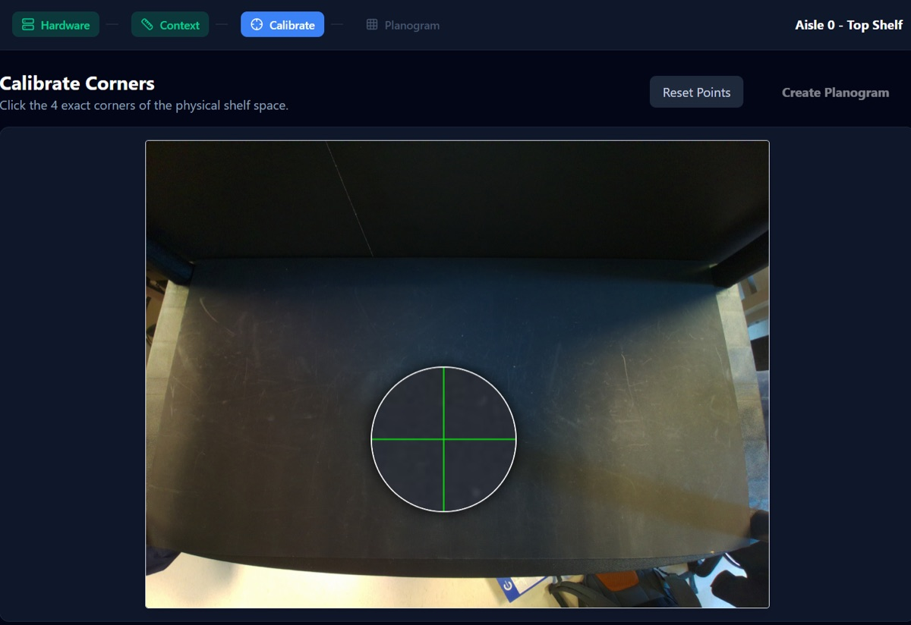
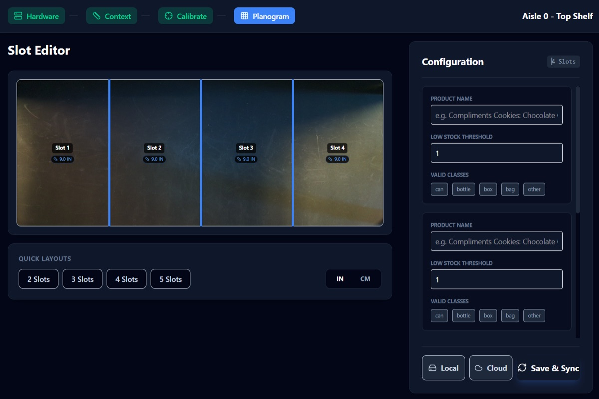

# Planogram Tool

A small web app (React + FastAPI) for registering a camera-equipped shelf with ViziStock. It produces the `planogram_config.json` that the [inference server](../inference_server) and [camera nodes](../camera_node) use. It can also publish the config to Firestore (`planograms/master_config`) for the [Android app](../android_app).

<p align="center">
  
  
</p>

## Workflow

1. **Hardware** — pick the camera (`cam_0`, `cam_1`).
2. **Context** — capture a live photo from that shelf's Pi (via the camera node's [`capture_server.py`](../camera_node/capture_server.py)) and enter the shelf's real-world dimensions. If the Pi can't be reached, the backend falls back to the local webcam.
3. **Calibrate** — click the four corners of the shelf. The backend computes a homography and returns a top-down "virtual" view of the shelf.
4. **Planogram** — divide the virtual shelf into slots and set each slot's product name, allowed classes (`box`, `bag`, `bottle`, …) and low-stock threshold. Save to a local file, Firestore, or both.

## Running

### Backend (`backend/`)

```bash
cd backend
pip install fastapi uvicorn opencv-python numpy python-multipart pydantic firebase-admin requests
# or: uv sync

export FIREBASE_CREDENTIALS=/path/to/firebase-service-account.json
export CAM_0_HOST=<cam-0-pi-ip>      # optional, for live capture from the Pis
export CAM_1_HOST=<cam-1-pi-ip>

python main.py                        # serves on http://127.0.0.1:8000
```

| Endpoint | Description |
|---|---|
| `GET /api/cameras` | List of configured cameras |
| `GET /api/capture?shelf_id=cam_0` | Live photo from the shelf's Pi (or local webcam fallback) |
| `POST /api/calibrate` | Image + 4 corner points → warped image + homography matrix |
| `POST /api/save` | Saves the planogram to `planogram_config.json` and/or Firestore |

### Frontend (`frontend/`)

```bash
cd frontend
npm install
npm run dev                           # http://localhost:5173
```

The frontend expects the backend at `http://localhost:8000`.
